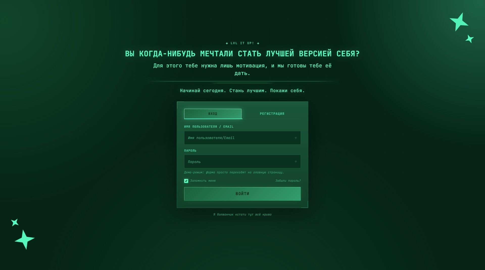
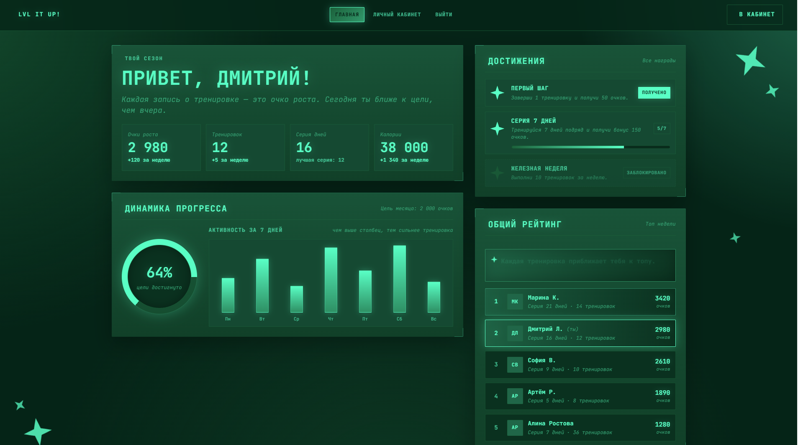
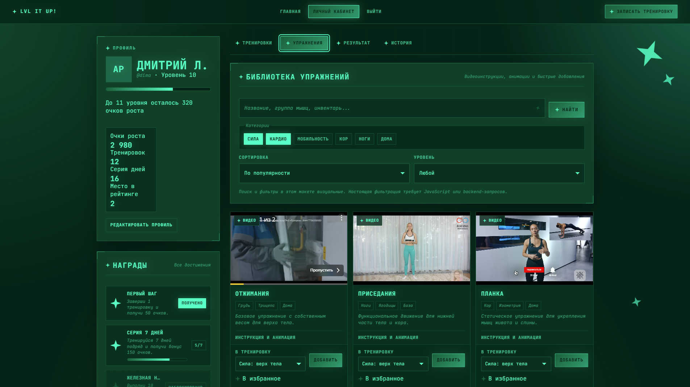

# ✦ LVL IT UP!

**Геймифицированный фитнес-трекер** — превращай тренировки в очки роста, поднимай уровень и становись лучшей версией себя.

> «Закономерность роста — маленький шаг каждый день даёт большую трансформацию.»


---

## 📸 Скриншоты

| Страница входа | Главная (дашборд) | Личный кабинет |
|---|---|---|
|  |  |  |

---

## 🎯 О проекте

**LVL IT UP!** — это веб-приложение для учёта тренировок с RPG-механикой. Каждая завершённая тренировка приносит очки роста, повышает уровень, увеличивает серию дней и открывает достижения.

### Ключевые идеи
- 🌟 **Очки роста** — валюта прогресса за каждую тренировку
- 📈 **Уровни** — повышаются каждые 300 очков
- 🔥 **Серии дней** — мотивация тренироваться регулярно
- ✦ **Достижения** — «Первый шаг», «Серия 7 дней», «Железная неделя»
- 📊 **Рейтинг** — сравнение с другими пользователями
- 🎬 **Библиотека упражнений** — с видеоинструкциями (Rutube embed)

---

## ️ Функционал

### 🔐 Аутентификация (`index.html`)
- Регистрация нового аккаунта
- Вход по email и паролю
- Демо-аккаунты для быстрого старта
- Валидация паролей

###  Главная страница — Дашборд (`main.html`)
- Приветствие по имени пользователя
- Статистика: очки, тренировки, серия дней, калории
- Круговой прогресс-бар цели месяца (`conic-gradient`)
- График активности за 7 дней
- Список достижений с прогрессом
- Общий рейтинг пользователей (топ-5)
- Мотивационные цитаты с ротацией

### 👤 Личный кабинет (`cabinet.html`)

**Профиль:**
- Имя, handle (автоматически из email), уровень
- Прогресс-бар до следующего уровня
- Статистика: очки, тренировки, серия, место в рейтинге
- Редактирование профиля (имя, город, цель, о себе)

**Тренировки:**
- Список активных и завершённых тренировок
- Создание новой тренировки (название, тип, длительность, сложность, теги)
- Редактирование и удаление
- Кнопка «Завершить» — автоматически записывает результат

**Библиотека упражнений:**
- Карточки с видео (Rutube embed)
- Теги: группа мышц, тип, локация
- Инструкция по технике выполнения
- Быстрое добавление в тренировку
- Избранное

**Результат:**
- Форма записи тренировки после выполнения
- Подходы, повторы, вес, отдых
- Метрики: очки, калории, пульс, самочувствие, техника
- Сохранение черновика

**История:**
- Хронология всех тренировок
- Фильтры по типу и статусу
- Детальный просмотр с таблицей упражнений
- Редактирование и удаление записей

---

## 🛠 Технологии

| Слой | Технология |
|------|-----------|
| Разметка | HTML5 (семантическая) |
| Стили | CSS3 (Grid, Flexbox, Custom Properties, `color-mix`, `conic-gradient`) |
| Логика | Vanilla JavaScript (ES6+) |
| Хранилище | `localStorage` (имитация БД) |
| Видео | Rutube embed (iframe) |
| Анимации | CSS Keyframes + `prefers-reduced-motion` |

### Особенности реализации
- ✅ **Без фреймворков** — чистый JS, никаких зависимостей
- ✅ **Адаптивная вёрстка** — брейкпоинты от 480px до 1440px
- ✅ **Доступность** — `prefers-reduced-motion`, `focus-visible`, `aria-*`
- ✅ **Модульная структура** — разделение `app.js` (логика) и `storage.js` (данные)
- ✅ **Дизайн-система** — CSS-переменные для цветов, радиусов, теней
- ✅ **Киберпанк-эстетика** — сетка на фоне, неоновые свечения, звёзды-clip-path

---

## 📁 Структура проекта

```
lvl-it-up/
├── index.html          # Вход и регистрация
── main.html           # Главная (дашборд)
├── cabinet.html        # Личный кабинет
├── style.css           # Общие стили + страница входа
├── main.css            # Стили дашборда
├── cabinet.css         # Стили кабинета
├── app.js              # Основная логика приложения
├── storage.js          # Слой данных (DB + localStorage)
── screenshots/        # Скриншоты для README
│   ├── auth.png
│   ├── dashboard.png
│   └── cabinet.png
── README.md           # Этот файл
```

---

## 🚀 Как запустить

### Способ 1: Просто открыть
Проект не требует сборки. Открой `index.html` в браузере — и всё работает.

### Способ 2: Через локальный сервер (рекомендуется)

```
# Python 3
python -m http.server 8000

# Node.js (http-server)
npx http-server -p 8000
```

Затем открой: http://localhost:8000

### Способ 3: VS Code
Установи расширение Live Server → ПКМ по index.html → Open with Live Server.
⚠️ Важно: localStorage работает и при открытии файла напрямую (file://), но для корректной работы роутинга лучше использовать сервер.

## 👤 Демо-аккаунты

При первом запуске автоматически создаются 5 демо-пользователей:

| Имя | Email | Пароль | Очки | Уровень |
| --- | --- | --- | --- | --- |
| Марина К. | `marina@demo.ru` | `demo1234` | 3 420 | 12 |
| Дмитрий Л. | `dima@demo.ru` | `demo1234` | 2 980 | 10 |
| София В. | `sofia@demo.ru` | `demo1234` | 2 610 | 9 |
| Артём Р. | `artem@demo.ru` | `demo1234` | 1 890 | 7 |
| **Алина Ростова** | `alina@demo.ru` | `demo1234` | 1 280 | 5 |

Пароль у всех одинаковый: **`demo1234`**
---

## 🎮 Как работает геймификация

### Начисление очков
- Завершение тренировки: `длительность × 4` очков
- Калории считаются как `длительность × 9`

### Уровни
- Уровень = `Math.floor(очки / 300) + 1`
- Каждые 300 очков — новый уровень.

### Серия дней
- Тренировка сегодня после вчерашней → серия +1
- Пропуск дня → серия сбрасывается до 1
- Лучшая серия сохраняется отдельно

### Достижения
- ✦ **Первый шаг** — завершить 1 тренировку (+50 очков)
- ✦ **Серия 7 дней** — тренироваться 7 дней подряд (+150 очков)
- ✦ **Железная неделя** — 10 тренировок за неделю
---

## 🎨 Дизайн

### Цветовая палитра
- **Фон:** глубокий тёмно-зелёный `#002417`
- **Неон:** яркий зелёный акцент `#1CFFC6`
- **Вспомогательный:** приглушённый зелёно-серый `#03613C`
- **Текст:** мутный для второстепенного, неоновый для заголовков

### Визуальные приёмы
- Сетка на фоне (как в киберпанке)
- Светящиеся рамки у панелей (угловые скобки)
- Звёзды-clip-path как иконки
- Пульсирующие кольца у медиа
- Градиентные прогресс-бары
- Backdrop-blur у топбара
- Анимация `floatDecorStar` для декоративных звёзд
---

## 📋 Планы развития

- [ ] Backend на Node.js + PostgreSQL (замена localStorage)
- [ ] Авторизация через JWT
- [ ] Загрузка фото профиля
- [ ] Экспорт истории в PDF
- [ ] Таймер для тренировок
- [ ] Push-уведомления о серии
- [ ] Социальные функции (друзья, челленджи)
- [ ] PWA — установка на телефон
- [ ] Тёмная/светлая тема (переключатель)
- [ ] Интеграция с фитнес-браслетами

---

## 📄 Лицензия

MIT © 2026 LVL IT UP!

---

*Сделано с ✦ и дисциплиной.*
